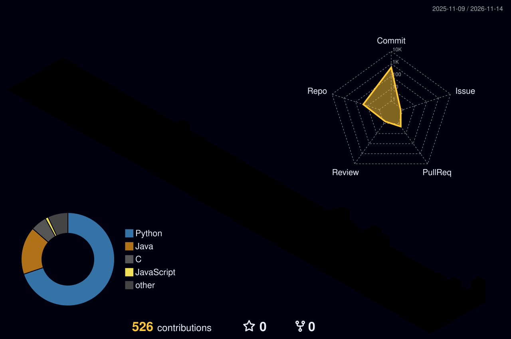

目前在成都，专注于 AI Agent 与新兴事件交通预测

个人网站 [Kosmigen](https://kosmigen.github.io/PureLearning/) · [X @kosmigen](https://x.com/kosmigen)

![Visual Studio Code](https://img.shields.io/badge/Visual%20Studio%20Code-0078d7.svg?style=for-the-badge&logo=data%3Aimage%2Fsvg%2Bxml%3Bbase64%2CPHN2ZyB4bWxucz0iaHR0cDovL3d3dy53My5vcmcvMjAwMC9zdmciIHZpZXdCb3g9IjAgMCAxMDAgMTAwIj48cGF0aCBmaWxsPSIjZmZmIiBmaWxsLXJ1bGU9ImV2ZW5vZGQiIGNsaXAtcnVsZT0iZXZlbm9kZCIgZD0iTTcwLjkxMTkgOTkuMzE3MUM3Mi40ODY5IDk5LjkzMDcgNzQuMjgyOCA5OS44OTE0IDc1Ljg3MjUgOTkuMTI2NEw5Ni40NjA4IDg5LjIxOTdDOTguNjI0MiA4OC4xNzg3IDEwMCA4NS45ODkyIDEwMCA4My41ODcyVjE2LjQxMzNDMTAwIDE0LjAxMTMgOTguNjI0MyAxMS44MjE4IDk2LjQ2MDkgMTAuNzgwOEw3NS44NzI1IDAuODczNzU2QzczLjc4NjIgLTAuMTMwMTI5IDcxLjM0NDYgMC4xMTU3NiA2OS41MTM1IDEuNDQ2OTVDNjkuMjUyIDEuNjM3MTEgNjkuMDAyOCAxLjg0OTQzIDY4Ljc2OSAyLjA4MzQxTDI5LjM1NTEgMzguMDQxNUwxMi4xODcyIDI1LjAwOTZDMTAuNTg5IDIzLjc5NjUgOC4zNTM2MyAyMy44OTU5IDYuODY5MzMgMjUuMjQ2MUwxLjM2MzAzIDMwLjI1NDlDLTAuNDUyNTUyIDMxLjkwNjQgLTAuNDU0NjMzIDM0Ljc2MjcgMS4zNTg1MyAzNi40MTdMMTYuMjQ3MSA1MC4wMDAxTDEuMzU4NTMgNjMuNTgzMkMtMC40NTQ2MzMgNjUuMjM3NCAtMC40NTI1NTIgNjguMDkzOCAxLjM2MzAzIDY5Ljc0NTNMNi44NjkzMyA3NC43NTQxQzguMzUzNjMgNzYuMTA0MyAxMC41ODkgNzYuMjAzNyAxMi4xODcyIDc0Ljk5MDVMMjkuMzU1MSA2MS45NTg3TDY4Ljc2OSA5Ny45MTY3QzY5LjM5MjUgOTguNTQwNiA3MC4xMjQ2IDk5LjAxMDQgNzAuOTExOSA5OS4zMTcxWk03NS4wMTUyIDI3LjI5ODlMNDUuMTA5MSA1MC4wMDAxTDc1LjAxNTIgNzIuNzAxMlYyNy4yOTg5WiIvPjwvc3ZnPgo%3D&logoColor=white)
![Codex](https://img.shields.io/badge/Codex-10A37F?style=for-the-badge&logo=data%3Aimage%2Fsvg%2Bxml%3Bbase64%2CPHN2ZyB4bWxucz0iaHR0cDovL3d3dy53My5vcmcvMjAwMC9zdmciIHhtbG5zOnhsaW5rPSJodHRwOi8vd3d3LnczLm9yZy8xOTk5L3hsaW5rIiB2aWV3Qm94PSIwIDAgMjQwNiAyNDA2Ij48cGF0aCBpZD0iYSIgZmlsbD0iI2ZmZiIgZD0iTTExMDcuMyAyOTkuMWMtMTk3Ljk5OSAwLTM3My45IDEyNy4zLTQzNS4yIDMxNS4zTDY1MCA3NDMuNXY0MjcuOWMwIDIxLjQgMTEgNDAuNCAyOS40IDUxLjRsMzQ0LjUgMTk4LjUxNVY4MzMuM2guMXYtMjcuOUwxMzcyLjcgNjA0YzMzLjcxNS0xOS41MiA3MC40NC0zMi44NTcgMTA4LjQ3LTM5LjgyOEwxNDQ3LjYgNDUwLjNDMTM2MSAzNTMuNSAxMjM3LjEgMjk4LjUgMTEwNy4zIDI5OS4xem0wIDExNy41LS42LjZjNzkuNjk5IDAgMTU2LjMgMjcuNSAyMTcuNiA3OC40LTIuNSAxLjItNy40IDQuMy0xMSA2LjFMOTUyLjggNzA5LjNjLTE4LjQgMTAuNC0yOS40IDMwLTI5LjQgNTEuNFYxMjQ4bC0xNTUuMS04OS40Vjc1NS44Yy0uMS0xODcuMDk5IDE1MS42MDEtMzM4LjkgMzM5LTMzOS4yeiIvPjx1c2UgeGxpbms6aHJlZj0iI2EiIHRyYW5zZm9ybT0icm90YXRlKDYwIDEyMDMgMTIwMykiLz48dXNlIHhsaW5rOmhyZWY9IiNhIiB0cmFuc2Zvcm09InJvdGF0ZSgxMjAgMTIwMyAxMjAzKSIvPjx1c2UgeGxpbms6aHJlZj0iI2EiIHRyYW5zZm9ybT0icm90YXRlKDE4MCAxMjAzIDEyMDMpIi8%2BPHVzZSB4bGluazpocmVmPSIjYSIgdHJhbnNmb3JtPSJyb3RhdGUoMjQwIDEyMDMgMTIwMykiLz48dXNlIHhsaW5rOmhyZWY9IiNhIiB0cmFuc2Zvcm09InJvdGF0ZSgzMDAgMTIwMyAxMjAzKSIvPjwvc3ZnPgo%3D&logoColor=white)

<h3 align="center">Github Stats</h3>

---

<h3 align="center">Latest Posts</h3>

- [学习和体育是一种“奢侈品”](https://kosmigen.github.io/PureLearning/blog/2026/11/10/learning-and-sports-are-a-luxury/) · 2026-11-10
- [和导师讨论研究方向](https://kosmigen.github.io/PureLearning/blog/2026/11/05/discussing-research-direction-with-advisor/) · 2026-11-05
- [使用 AI 及相关产品进行开发的最佳实践](https://kosmigen.github.io/PureLearning/blog/2026/08/26/ai-development-best-practices/) · 2026-08-26
- [最近的学习好像没有太多的收获](https://kosmigen.github.io/PureLearning/blog/2026/08/19/feeling-like-i-havent-learned-much/) · 2026-08-19

<a href="https://kosmigen.github.io/PureLearning/blog/">查看更多文章 →</a>

<h3 align="center">Github Contribution</h3>

